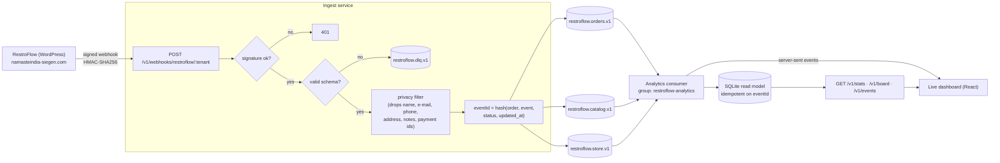
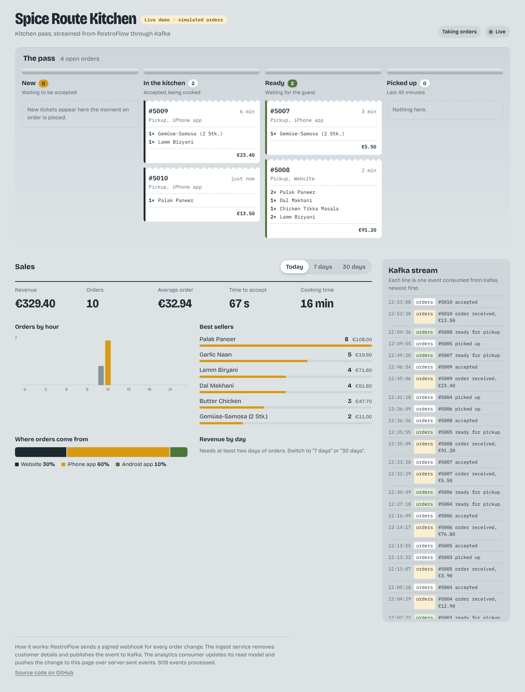

# RestroFlow Events

**Real-time event platform for restaurant ordering, built on Apache Kafka.**

[RestroFlow](https://namasteindia-siegen.com/online-bestellen/) is a WordPress ordering system I built for restaurants (online ordering, kitchen display, POS integration). This project turns its order flow into a stream of events: signed webhooks go into Kafka, personal data is removed on the way in, and independent consumers build live statistics. It runs against a real restaurant (Namaste India, Siegen), without being in its critical path.





## What it does

| | |
|---|---|
| **Ingest** (`services/ingest`) | Fastify service. Verifies RestroFlow's `X-RestroFlow-Signature` over the raw body (constant-time), validates the payload with Zod, strips personal data, assigns a stable event ID and publishes to Kafka with an idempotent producer (`acks=all`). |
| **Analytics** (`services/analytics`) | Kafka consumer group that projects events into a SQLite read model and serves statistics: orders and revenue, orders per hour (restaurant time zone), best sellers, time to accept and preparation time, web vs. iOS vs. Android, store paused/open. |
| **Dashboard** (`apps/dashboard`) | React page served by the analytics service. The kitchen pass shows every open order as a ticket on its lane (new, in the kitchen, ready, picked up) and moves it the moment the next Kafka event is consumed, via server-sent events. Below it: sales figures, orders by hour, best sellers, channels, revenue by day and the raw event stream. |
| **Contracts** (`packages/contracts`) | Shared event schemas, topic names, privacy filter, signature helpers and realistic fake payloads. |

## Design decisions

**Privacy by design (GDPR).** The webhook contains customer name, e-mail, phone, address and free-text notes. The Kafka event types simply have no fields for them, so they can't leak by accident. A runtime guard checks every outgoing event for forbidden keys, and even the dead-letter queue stores only a scrubbed copy plus a SHA-256 of the original body.

**Exactly-once effects on an at-least-once pipeline.** RestroFlow retries failed webhooks (after 1, 5, 30, 120 and 360 minutes) with a *new* delivery ID each time. The event ID is therefore derived from the business fact (`order + event + status + updated_at`), not the delivery. Duplicates are filtered at the edge (LRU) and, as the real guarantee, the consumer records each event ID in the same SQLite transaction as its effects.

**Back-pressure instead of data loss.** If Kafka is unreachable, ingest answers `503`, and RestroFlow's own retry schedule delivers the webhook later. Authentic but malformed payloads get `202` and go to the dead-letter topic, so they're kept for inspection without being retried forever.

**Ordering where it matters.** Messages are keyed by `tenant:order:<id>`, so all events of one order land on the same partition and are consumed in order. A stale snapshot that still arrives late (an old retry) is ignored by comparing `occurredAt`.

**Multi-tenant from day one.** Each restaurant has its own webhook secret and URL segment (`/v1/webhooks/restroflow/<tenant>`). The tenant is part of every key and every row.

**Live without polling Kafka from the browser.** The browser never talks to Kafka. The analytics consumer applies each event to its read model first, then pushes a small summary over server-sent events; the page re-reads the board and statistics from the same read model, so what you see always matches the stored state. After a reconnect the page re-syncs automatically.

**Replay.** Deleting the read model and starting the consumer with a new group ID rebuilds every statistic from the retained events, which is useful when a new metric is added.

## Run it locally

Requirements: Node 22.13+ and Docker.

```bash
npm install
docker compose up -d --build        # Kafka (KRaft), Kafka UI, ingest, analytics
npm run simulate -- --orders 25     # an evening of signed, fake orders
open http://localhost:8081          # live dashboard
curl localhost:8081/v1/stats/namaste-india-siegen | jq
open http://localhost:8090          # Kafka UI: topics, messages, consumer lag
```

For dashboard development with hot reload: `npm run dev:dashboard` (proxies the API to the analytics service on :8081).

The simulator also sends a webhook retry (answered as `duplicate`), a declined order, a sold-out dish and a broken payload (dead-lettered).

## Tests

```bash
npm test                    # unit tests: signature, schema, privacy, idempotency, statistics, HTTP
npm run test:integration    # end-to-end against a real broker (docker compose up -d kafka)
```

CI (GitHub Actions) runs the type check and unit tests, then the end-to-end test against a real Kafka 4.1 broker, and builds both Docker images.

## Connecting a real restaurant

1. Deploy `ingest` (any Node host or container platform with HTTPS) with `TENANTS='{"<slug>":"<secret>"}'` and Kafka credentials (see `.env.example`; works with managed Kafka such as Aiven using SASL/SCRAM + TLS).
2. In WordPress: **RestroFlow → Webhooks → Add**. URL `https://<ingest-host>/v1/webhooks/restroflow/<slug>`, format *RestroFlow*, the same secret, events: all.
3. Deploy `analytics` next to it and open `/v1/stats/<slug>`.

## Tech

TypeScript · Node.js 22 · Apache Kafka 4 (KRaft) · `@confluentinc/kafka-javascript` (librdkafka) · Fastify · Zod · SQLite (`node:sqlite`) · React 19 · Vite · server-sent events · Vitest · Docker · GitHub Actions

## Roadmap

- [x] Ingest with signature check, privacy filter, idempotent producer, dead-letter queue
- [x] Analytics consumer with idempotent read model and stats API
- [x] Docker Compose stack, simulator, CI with real Kafka
- [x] Live dashboard (React, server-sent events)
- [ ] Alerting consumer ("order not accepted after 10 minutes")
- [ ] Schema Registry (Avro/JSON Schema) for versioned events
- [ ] Live deployment: Hetzner VPS + Aiven Kafka, continuous deployment over SSH, HTTPS via Caddy – see [deploy/server](deploy/server/README.md)
